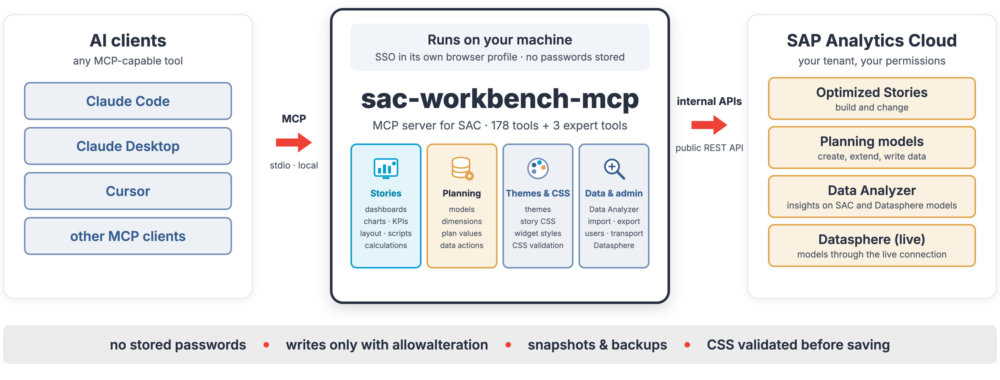

# sac-workbench-mcp

An unofficial [Model Context Protocol](https://modelcontextprotocol.io) server that lets an AI assistant (Claude
Desktop, Claude Code or any other MCP client) work with **SAP Analytics Cloud**: build and change stories, charts,
KPIs, themes and CSS, create planning models and dimensions, write plan values, load data, and use the public
REST APIs.



> ## ⚠️ Disclaimer — read before use
>
> - This project is **not affiliated with, endorsed, sponsored or supported by SAP SE**. "SAP" and "SAP Analytics
>   Cloud" are trademarks of SAP SE; they are used here only to describe what the software works with.
> - Large parts of this server use **undocumented, internal SAP Analytics Cloud interfaces** (the requests the SAC web
>   UI itself sends). They were found by recording the UI, not from SAP documentation.
> - These URLs, payloads and behaviours are **not a stable API**. They **may change or break with any SAC update**,
>   without notice.
> - **SAP does not support this software** or any change it makes to your tenant. Do not open SAP support tickets
>   for problems caused by it.
> - **Use at your own risk.** Test in a sandbox tenant or folder first, keep backups, and review what the assistant
>   is about to change. The authors accept no liability (see [LICENSE](LICENSE)).

## 📖 Featured Blog Posts

sac-workbench-mcp is built at [NextLytics](https://www.nextlytics.com/en/), a consultancy for data platforms, analytics and
planning. More on SAP Analytics Cloud on the [NextLytics blog](https://www.nextlytics.com/blog/tag/sap-analytics-cloud).

1. **Trick or Theme: Dark Mode in SAP Analytics Cloud** — a use case built with this server: the dark theme, the story
   CSS and the dashboard in the post were created and tuned through the MCP server.
   https://www.nextlytics.com/blog/trick-or-theme-dark-mode-in-sap-analytics-cloud
2. **Controlling SAP Analytics Cloud with Claude: a home-built MCP server** — the introduction to this server: what
   it does, how it works and what we learned building it.
   https://www.nextlytics.com/blog/controlling-sap-analytics-cloud-with-claude-a-home-built-mcp-serve

Sister project for SAP BW/4HANA: [bw-modeling-mcp](https://github.com/dnic-dev/bw-modeling-mcp) —
[Agentic AI meets SAP BW](https://www.nextlytics.com/blog/agentic-ai-meets-sap-bw).

## What's new — v0.3.0

First public release. Highlights: complete dashboards in one call (on Datasphere models and on SAC models — planning, Seamless and analytic), declarative chart editing (type, feeds, filters,
hierarchy, colours), restricted and calculated measures, KPI tiles as Numeric Point, layout checks per screen width,
planning models with dimensions, hierarchies and data reloads, and Datasphere model search. See
[CHANGELOG.md](CHANGELOG.md).

## What it can do

178 tools in these areas, plus 3 expert tools for extending the server ([see below](#extending-the-server-expert-tools)) — the full list with parameters is in [TOOLS.md](TOOLS.md), how it works inside in
[ARCHITECTURE.md](ARCHITECTURE.md):

| Area | Examples |
|---|---|
| Stories | `sac_story_generate_dashboard` (complete dashboard in one call), `sac_story_add_widget`, `sac_story_add_kpi` (KPI tile as Numeric Point), `sac_story_duplicate`, `sac_story_set_text`, `sac_story_set_layout`, `sac_story_set_position`, `sac_story_remove_widget` |
| Charts | `sac_story_chart` / `sac_story_chart_get` (type, measures, dimensions, colour/pattern, legend, hierarchy level, member and dynamic date filters), `sac_story_set_colors`, `sac_story_calculation` (restricted and calculated measures), `sac_story_add_variance`, `sac_story_add_threshold` |
| Look & feel | `sac_theme_create` / `sac_theme_update` (with CSS validation against the SAC rules), `sac_story_css`, `sac_story_style_widget`, `sac_story_format_widget`, `sac_composite_header_create` |
| Scripting | `sac_scripts_get`, `sac_script_event_set`, `sac_script_function_set`, `sac_script_variable_set`, `sac_story_check_runtime`, `sac_story_inspect` (layout check: scrollbars, overhang, errors per widget) |
| Story internals | `sac_story_get`, `sac_story_transform` (patch by function in an isolated context — not a security boundary, automatic snapshot), `sac_story_restore`, `sac_story_snapshot`, `sac_story_diff`, `sac_story_patch` |
| Planning | `sac_planning_model_create`, `sac_model_dimension_add`, `sac_model_hierarchy_set`, `sac_model_members_set`, `sac_model_data_reload`, `sac_plan_read` / `sac_plan_write` / `sac_plan_publish` / `sac_plan_revert`, `sac_dataaction_create` / `_run`, `sac_multiaction_create`, `sac_planning_story_create`, `sac_planning_forecast_story_create` |
| Data Analyzer & models | `sac_insight_create` / `_update`, `sac_live_model_create`, `sac_models_list`, `sac_model_metadata`, `sac_datasphere_search` (find a Datasphere model's space without a Datasphere login) |
| Files | `sac_files_list`, `sac_folder_create`, `sac_resource_move` / `_rename` / `_delete` (to Deleted Files), `sac_stories_copy` |
| Public REST APIs | data import / export, users & teams (SCIM), content transport, schedules, calendar, translation, audit, multi actions |
| Exploring | `sac_capture_start` / `_stop` / `_get` (record what the SAC UI sends), `sac_contentlib`, `sac_browser_ui`, `sac_browser_screenshot`; expert tools 🔧 `sac_replay`, `sac_api_request`, `sac_browser_eval` (off by default) |

### Try it

Once the server is connected, just ask in plain language. A few prompts to start with (use your own model and folder
names):

> Build me an overview dashboard on the model `SALES_PLAN` in my folder "Test": four KPI tiles for revenue and
> quantity, actual vs. plan, two bar charts by region and by product, and a table by product. Use the Horizon
> template and show the numbers in millions.

> Which models can I build stories on? Show me the dimensions and measures of `SALES_PLAN`.

> Create a dark theme for our stories: dark grey background, white text, blue as accent colour, and apply it to the
> story "Sales Overview".

> In `SALES_PLAN`, raise the 2026 plan for Germany by 5 % in the private version and show me before and after —
> don't publish yet.

> The button on page 1 of "Sales Overview" should filter the chart by the selected year. Write the script and check
> the story for errors.

The assistant asks for whatever it needs (model, theme, layout) and states every change before it makes it.

Guidance for good stories (layout, naming, minimal look, colours) is in [docs/STORY_GUIDELINES.md](docs/STORY_GUIDELINES.md)
and is also offered to the client as the MCP prompt `story_guidelines`.

## Skills for scripting and CSS

[skills/](skills/) contains two Agent Skills — `sac-scripting` (SAC scripts against the official API reference) and
`sac-css` (story/theme CSS with only the classes and properties SAC accepts). They work with this server and on their
own. The scripting reference is built locally from SAP's public documentation; see [skills/README.md](skills/README.md).

## How it works

- **Browser session (main path).** The server starts its own Chrome profile with Playwright. You sign in once via
  SSO (`npm run login`); the session is kept in the profile. Requests are sent from inside the signed-in SAC page,
  with the CSRF handling the UI uses. **No passwords are stored or entered by the server.**
- **OAuth client (optional).** No tool needs one: without it, the documented public REST APIs (`/api/v1/...` — data
  import/export, users and teams, transport, schedules, calendar, translation, audit) also go through the browser
  session. Configure an OAuth client (client credentials) only if those calls should run as a technical user.
  Everything else always uses the browser session.
- **Recorded templates.** `templates/` contains payloads recorded from the SAC UI with placeholders; the server fills
  in your tenant, user, folder, model and ids at runtime.

## Requirements

- Node.js 22 or newer
- Google Chrome (or set `SAC_BROWSER_CHANNEL`)
- An SAP Analytics Cloud tenant and a user with the rights you want the assistant to use. For Datasphere models a
  live connection to SAP Datasphere.

## Setup

### From npm

```bash
npm install -g sac-workbench-mcp
sac-workbench-mcp setup     # asks for the tenant URL and defaults, opens Chrome for the SSO login
```

The configuration goes to `~/.sac-mcp/config.json`, so updates (`npm install -g sac-workbench-mcp@latest`) keep it.
Sign in again later with `sac-workbench-mcp login`. With Claude Code: `claude mcp add sac -- sac-workbench-mcp`.

### From source

```bash
git clone https://github.com/RafaelSachsNL/sac-workbench-mcp.git
cd sac-workbench-mcp
npm install
npm run setup     # asks for the tenant URL and defaults, builds, opens Chrome for the SSO login
```

Recordings, snapshots and data backups go to `captures/` in the repository folder (git-ignored).

`npm run setup` writes `sac-mcp.config.json` (see [sac-mcp.config.example.json](sac-mcp.config.example.json)) and can
register the server in Claude Desktop. Manual registration:

```json
{
  "mcpServers": {
    "sac": { "command": "node", "args": ["/absolute/path/to/sac-workbench-mcp/build/index.js"] }
  }
}
```

With Claude Code, one line does the same:

```bash
claude mcp add sac -- node /absolute/path/to/sac-workbench-mcp/build/index.js
```

On Windows use the full path with escaped backslashes in JSON, e.g.
`"args": ["C:\\Users\\you\\sac-workbench-mcp\\build\\index.js"]`.

Sign in again later with `npm run login`.

Tested against SAP Analytics Cloud **2026.21** (Optimized Story Experience). SAC updates can change the internal
interfaces; the smoke test (see [Development](#development)) shows quickly what broke.

### Configuration

`sac-mcp.config.json` (lookup: `$SAC_MCP_CONFIG` → `<repo>/sac-mcp.config.json` → `~/.sac-mcp/config.json`);
environment variables override it.

| Setting | Env variable | Meaning |
|---|---|---|
| `tenantUrl` | `SAC_BASE_URL` | e.g. `https://mytenant.eu10.hcs.cloud.sap` |
| `user` | `SAC_USER` | SAC user id; detected when empty |
| `readOnly` | `SAC_READ_ONLY` | `true` blocks every write operation |
| `expertTools` | `SAC_EXPERT_TOOLS` | `true` also loads `sac_browser_eval`, `sac_api_request` and `sac_replay` (raw access, off by default) |
| `defaults.connection` / `.space` / `.folderId` | `SAC_DEFAULT_CONNECTION` / `_SPACE` / `_FOLDER` | defaults for Datasphere models and new stories |
| `browser.profileDir` / `.channel` / `.headless` | `SAC_BROWSER_PROFILE` / `_CHANNEL` / `_HEADLESS` | Chrome profile and mode |
| `oauth.clientId` / `.clientSecret` / `.tokenUrl` | `SAC_CLIENT_ID` / `_SECRET` / `SAC_TOKEN_URL` | optional OAuth client for `/api/v1` |
| – | `SAC_BRAND_PREFIX` | e.g. `ACME\|AC`: your own themes/templates are recommended first |
| – | `SAC_CAPTURE_DIR` | where recordings, snapshots and data backups go (default `captures/`) |

## Troubleshooting

| Symptom | Fix |
|---|---|
| "Not logged into SAC within …" | The SSO session expired: call `sac_browser_login` from the assistant, or run `npm run login` (`sac-workbench-mcp login` for an npm install), and sign in. |
| Chrome does not start: profile "in use" / `SingletonLock` | Another server instance (or a Chrome window) uses the same profile. Close it; if no Chrome is running any more, delete the `Singleton*` files in the profile folder. Two instances need two profiles (`SAC_BROWSER_PROFILE`). |
| HTTP 403 on a write | The server already retries once with a fresh CSRF token. A 403 that stays means your SAC user lacks the right (e.g. on the folder or model); check it in SAC. |
| Nothing happens with `SAC_HEADLESS=true` | The SSO login needs a visible window. Log in once without headless, then switch it on. |
| A tool that worked before fails after an SAC update | See [docs/SAC_UPDATE.md](docs/SAC_UPDATE.md); if you cannot fix it, open an issue with the failing step and your SAC version (Help → About). |

## Safety

- **Every tool that changes something requires `allowalteration: true`.** Without it the tool refuses, so the
  assistant has to ask for and state the change.
- `readOnly: true` blocks all writes, whatever the assistant sends.
- `sac_resource_delete` moves files to *Deleted Files* (recoverable). Some public-API tools delete for good (e.g.
  `sac_users_delete`, `sac_transport_delete_content`, `sac_import_delete_job`) — their descriptions say so.
- `sac_story_transform` saves a snapshot before every change; `sac_story_restore` brings it back.
  `sac_model_data_reload` writes a CSV backup of the facts before replacing them.
- Planning values are written to the private version first; publishing (`sac_plan_publish`) is a separate step.
- Red/green series colours are refused until confirmed (`confirmSignalColors`) — they are signal colours.
- `captures/` (recordings, snapshots, backups) can contain business data and is git-ignored. Do not commit it.

Recommendation: give the assistant a test folder (`defaults.folderId`) and test models first.

## Development

```bash
npm run build                                              # TypeScript → build/
npm run smoke -- <folderId> [model] [connection] [space]   # end-to-end test against your tenant (creates and deletes test objects)
SMOKE_FORECAST="<seamless model>,<row dimension>,<measure>" npm run smoke -- …   # includes the forecast planning story
```

### Extending the server (expert tools)

Three tools give raw access to the tenant and are meant for developing new tools, not for everyday use. They are
**off by default** and only loaded with `"expertTools": true` in `sac-mcp.config.json` or `SAC_EXPERT_TOOLS=true`:

| Tool | What it does |
|---|---|
| `sac_browser_eval` | runs any JavaScript inside the signed-in SAC page (UI5/FPA runtime) |
| `sac_api_request` | sends any HTTP request to the tenant, documented or internal |
| `sac_replay` | replays a recorded UI request, optionally with changed parameters |

They bypass the guard rails of the regular tools (snapshots, validation, signal-colour check), so switch them on only
in a sandbox tenant while you develop.

To teach the server something new, record it: `sac_capture_start`, do the action in the SAC UI
(`sac_browser_ui` or by hand), `sac_capture_stop`, inspect with `sac_capture_get`, try the changed call with
`sac_replay`, then turn the payload into a tool. For stories, `sac_story_snapshot` → change in the UI → `sac_story_diff`
shows what SAC stores. See [CONTRIBUTING.md](CONTRIBUTING.md). Releases: [docs/RELEASE.md](docs/RELEASE.md).

## Acknowledgements

The public REST API tools (data import/export, users, transport, schedules …) started from
[JumenEngels/sap_analytics_cloud_mcp](https://github.com/JumenEngels/sap_analytics_cloud_mcp) (MIT). The story,
chart, theme, planning and model tools were added on top.

## License

[MIT](LICENSE). Provided "as is", without warranty of any kind — see the disclaimer above.
